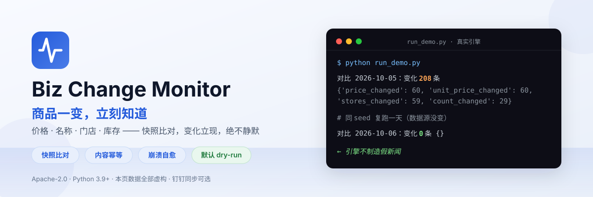
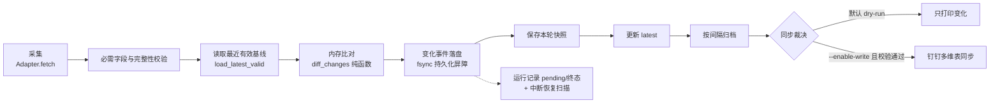

# GooseWatch · 看家大鹅

> **商品一变，立刻知道** —— 自动追踪价格、名称、门店与库存变化

<div align="center">
  
</div>

> **人工盯盘对账的替代品**：快照比对 · 内容幂等去重 · 崩溃自愈 · 默认 dry-run，数据不出本机。

<p align="center">
  <a href="https://classmatelu.github.io/goosewatch/demo.html">📺 在线演示（10 秒看效果，数据全部虚构）</a> ·
  <a href="#快速开始">快速开始</a> ·
  <a href="#它能发现哪些变化">能发现哪些变化</a> ·
  <a href="#可靠性说明如实声明">可靠性说明</a>
</p>


> ⚠️ **免责声明**：本项目仅供技术学习与工程实践使用，不构成商业产品。请仅在**自己有权访问的数据**范围内使用，使用前自行确认目标平台的服务条款与适用法律（详见[安全与合规声明](#安全与合规声明)）。

---

## 10 秒看到引擎在工作（真实输出 · 数据虚构）

```text
$ python run_demo.py
[昨日 2026-10-05] 完整性校验: PASS（60 个对象）
[今日 2026-10-06] 完整性校验: PASS（60 个对象）
对比 2026-10-05：变化 208 条 {'price_changed': 60, 'unit_price_changed': 60,
                              'stores_changed': 59, 'count_changed': 29}

# 同 seed 复跑一天（数据源没变）
对比 2026-10-06：变化 0 条 {}        ← 引擎不制造假新闻
```

任何人克隆仓库后运行 `python run_demo.py`，都会得到与上面逐字一致的输出——这是本项目的信任基础：**不演示无法复现的东西**。

## 这是什么

如果你在多个渠道或多家门店维护同一批商品（或任何「ID 稳定、属性会变」的业务对象），你大概每天都会遇到：

| 人工处理方式 | 自动监控的价值 |
|---|---|
| 商品 ID 没变，但名称 / 内容悄悄改了，靠逐个点开核对 | 以稳定业务 ID（gid）为关联键，持续记录每次可识别的属性变化 |
| 价格、优惠、适用门店分散在不同页面，变化难以追踪 | 每轮运行自动与最近有效快照比对，按字段生成结构化变化事件 |
| 用 Excel 手工比对耗时，且变化过程无法追溯 | 变化事件按月持久化为 JSONL，带时间戳与基线信息，可回溯 |

**它做什么**：采集 → 规范化 → 与历史有效快照比对 → 生成变化事件 → 持久化 → （可选）同步到钉钉多维表 / 群通知。

**它不做什么**：不绕过任何平台的登录、权限或安全机制；不内置任何特定平台的正式适配器；不实时推送（按配置的周期轮询）。

## 它能发现哪些变化

以下字段均由当前代码实际支持（`core/diff.py`）：

| 变化 | 事件类型 | 说明 |
|---|---|---|
| 新对象出现 / 对象消失 | `new` / `removed` | 前提：本轮采集通过完整性校验 |
| 商品名称 | `name_changed` | 文本比对 |
| 价格 | `price_changed` | 数值规范化后按分比对（`"99.0"` ≡ `99` ≡ `99.00`） |
| 份数 / 库存 | `count_changed` | 数值比对 |
| 单价 | `unit_price_changed` | 按分比对 |
| 折扣 | `discount_changed` | 按 0.1% 精度比对 |
| 上下架状态 | `status_changed` | 文本比对 |
| 门店数量 | `store_count_changed` | 数值比对 |
| 适用门店集合 | `stores_changed` | 集合比对、顺序无关；同数量的一换一也能发现 |
| 字段键意外消失 | `{field}_missing` | 数据源结构异常时主动告警，不静默跳过 |

### 变化事件示例（完全虚构的数据，仅展示格式）

一次运行后，事件文件（JSONL）里会多出这样的记录：

```json
{
  "event_id": "3f9c2a1d8b7e4f06",
  "run_id": "20261011T100000-a1b2c3",
  "gid": "DEMO-001",
  "field": "price",
  "event_type": "price_changed",
  "name": "演示商品 A",
  "old_value": "88.0",
  "new_value": "78.0",
  "previous_observed_at": "2026-10-10T10:00:00+08:00",
  "observed_at": "2026-10-11T10:00:00+08:00"
}
```

控制台同时打印（真实输出样式，数据虚构）：

```text
[price_changed]  DEMO-001 演示商品 A 价格 88.0 → 78.0
```

## 工作流程



对应 `main.py` 的真实执行顺序。关键可靠性设计：

- **事件先于基线**：变化事件落盘（fsync）完成后才推进快照与 latest——基线不会领先于事件
- **内容幂等（存储层）**：event_id 由变化内容生成，同一基线对之间的同一变化跨运行去重，恢复重跑不产生重复记录
- **崩溃自愈**：进程中断或持久化失败后，下一轮以最近有效基线重新比对；已覆盖场景有专门的故障注入测试
- **默认 dry-run**：不显式启用写入时，绝不写多维表、绝不获取 accessToken（仅严重故障发送 Webhook 告警）

## 快速开始

### A. 安全演示（无需任何账号）

当前仓库自带虚构数据的示例适配器（`adapters/example_adapter.py`），演示模式满足：

- 全部数据虚构（`DEMO-*` 商品、示例门店）
- 不读取任何浏览器登录态、不访问任何真实业务接口
- 默认 dry-run：不发送真实钉钉通知、不写多维表
- 示例适配器带 `is_example` 标记，被硬性禁止写入真实表

```bash
git clone https://github.com/classmateLu/goosewatch.git
cd goosewatch
python3 -m venv venv && source venv/bin/activate
pip install -r requirements.txt

# 第一轮：建立基线（不产出变化事件）
python main.py --date 2099-01-01
# 第二轮：与基线比对（本轮开始检出变化）
python main.py --date 2099-01-02

# 或者：一条命令看完整可复现演示（真实引擎 + 固定 seed，快照写系统临时目录）
python run_demo.py
```

> 运行会在本地 `data/` 目录写入快照、事件与运行记录（均为虚构数据）。首次运行只建立基线，是预期行为。

### B. 接入你的数据源

- **Python 版本**：3.9+（CI 在 3.9–3.13 矩阵上测试）
- **依赖**：`pip install -r requirements.txt`（运行时仅 pyyaml；核心比对/快照/校验为标准库实现）
- **配置**：`cp config/config.example.yaml config/config.yaml` 并按注释填写；钉钉凭据从该文件读取（v0.1 不支持 .env，见 `.env.example` 内说明），`chmod 600` 保护
- **适配器**：在 `adapters/` 下新建模块，继承 `DataSource` 实现 `fetch()`，返回 `CollectionResult`：

```python
from .base import CollectionResult, DataSource
from core.models import make_item

class MyAdapter(DataSource):
    name = "my_platform"

    def fetch(self) -> CollectionResult:
        items = [make_item("ID-001", name="项目A", price=99.0, count=1)]
        stores = {"ID-001": ["门店1", "门店2"]}
        return CollectionResult(items=items, stores=stores, total=len(items),
                                failed_pages=[])
```

然后将 `main.py` 中的 `ExampleAdapter()` 换成你的适配器类。

- **运行**：`python main.py`（默认 dry-run）；显式写入钉钉需 `python main.py --enable-write`（需同时通过：数据源非示例适配器 + 钉钉配置齐备，否则拒绝执行）
- **检查输出**：变化事件在 `data/events/events-YYYYMM.jsonl`，运行记录在 `data/runlog/`，快照在 `data/snapshots/`

**接入真实平台的提醒**：

- 平台接口地址、页面结构、登录态处理等若涉及商业平台或内部系统，请保持在私有环境，**不要提交到公共仓库**
- `config/config.yaml` 与 `.env` 已被 `.gitignore` 排除，但请在提交前自行确认
- 浏览器自动化（如 Playwright）为可选依赖，其用户数据目录与登录态**不得**纳入版本控制

## 可靠性说明（如实声明）

| 能力 | 当前状态 |
|---|---|
| 变化识别 | 通过数值规范化与集合规范化，减少格式差异导致的无效记录 |
| 事件记录 | 存储层按内容幂等去重；持久化顺序有静态断言与故障注入测试覆盖 |
| 恢复机制 | 针对已覆盖的进程中断与持久化失败场景实现恢复；实际行为受文件系统与具体故障类型影响 |
| 通知 | 钉钉同步为 **at-least-once**：事件记录幂等 ≠ 通知端到端幂等，极端情况同一批次可能重复 |
| 轮询周期 | 按配置定时运行，不构成实时推送承诺 |
| 测试 | 核心监控逻辑与平台适配分离；关键流程有自动化测试（见下） |

## 测试

本仓库共七套测试（全部可直接执行，也可用 pytest 一键运行；断言数量以实际执行为准）：

```bash
python tests/test_diff.py             # Diff 引擎
python tests/test_hash_val.py         # 幂等键哈希层
python tests/test_crash_recovery.py   # 崩溃恢复与一致性
python tests/test_fault_injection.py  # 动态故障注入（实跑 main 主流程）
python tests/test_dingtalk_sync.py    # 钉钉同步安全
python tests/test_main_safety.py      # 主流程安全（默认零外呼等）
python tests/test_stage2.py           # v2 数据引擎
pytest tests/                         # 或一键全部
```

覆盖范围：新增/删除/名称/价格/份数/单价/折扣/状态/门店变化、多字段同变、数值规范化、字段缺失告警、内容幂等去重、崩溃恢复、故障注入恢复闭环、默认运行零外呼、写入安全闸门、严格响应校验、跨月恢复扫描。

## 架构

```
goosewatch/
├── core/            # 监控引擎
│   ├── models.py    #   数据模型与数值规范化
│   ├── diff.py      #   变化检测（纯函数，无 IO）
│   ├── validation.py#   采集完整性校验
│   ├── events.py    #   事件持久化（fsync + 去重）
│   ├── snapshot.py  #   快照 / latest / 归档（原子写）
│   └── runlog.py    #   运行状态机与中断恢复扫描
├── adapters/        # 数据源适配器（平台采集逻辑，按需定制）
├── notifications/   # 钉钉同步（多维表 + Webhook）
├── config/          # 配置模板
├── deploy/          # 定时运行模板（macOS launchd）
├── docs/            # 演示页与架构图
├── run_demo.py      # 可复现演示（真实引擎 + 示例数据，不触碰 data/）
└── tests/           # 七套测试
```

## 项目状态

- ✅ **阶段 1**：页面结构分析与数据可行性验证
- ✅ **阶段 2**：监控引擎改造（内容幂等 / 崩溃恢复 / 故障注入测试）——已合并 `main`
- ⏳ **阶段 3**：真实环境只读验证（PoC）——计划中
- ⏳ **阶段 4**：推送式触发降低响应延迟——计划中（当前为定时轮询）
- ⏳ **阶段 5**：钉钉通知层增强——计划中

> 开发进度以仓库分支与提交记录为准。

## 公开仓库 vs 原始生产环境

本项目源自真实业务对账场景，公开版本只保留可复用的通用部分：

| | 本公开仓库 | 原始生产环境 |
|---|---|---|
| 数据 | 完全虚构的示例数据 | 私有业务数据 |
| 凭据 / Cookie / 登录态 | 无 | 私有，永不入库 |
| Webhook | 示例配置 | 私有 |
| 用途 | 演示 / 学习 / 复用 | 真实业务流程 |

## 安全与合规声明

- 本项目是个人技术学习与工程实践作品，核心价值在于展示「以稳定业务 ID 关联、采集 → 快照 → 比对 → 通知」的通用工程实现，不构成商业产品或服务
- 请仅在**自己有权访问和处理的数据**范围内使用；使用前请自行确认目标平台的服务条款、合同义务及适用法律
- 本项目不提供绕过登录、权限或安全机制的功能
- 对运行产生的快照、事件与日志，请自行采取适当的访问控制与脱敏措施
- Meituan / DingTalk（钉钉）等均为各自权利人的商标，本项目与其无关联
- 软件按「现状」提供（见下），使用者应自行评估适用风险

## License

[Apache-2.0](LICENSE)
